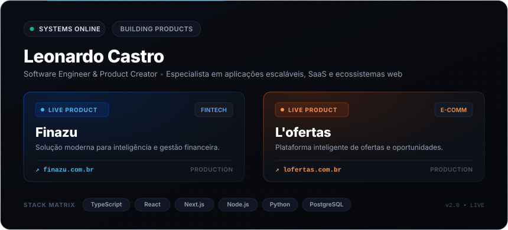

<div align="center">

  <!-- BANNER REFINADO EXECUTIVO -->
  

  <br><br>

  <!-- TYPING SVG ANIMADO -->
  <a href="https://git.io/typing-svg">
    
  </a>

  <br>

  <!-- BOTÕES REFINADOS COM PADDING E ALINHAMENTO IMPECÁVEL -->
  <p align="center">
    <a href="https://finazu.com.br" target="_blank">
      
    </a>
    &nbsp;
    <a href="https://lofertas.com.br" target="_blank">
      
    </a>
    &nbsp;
    <a href="https://github.com/LeonardoCastro01">
      
    </a>
    &nbsp;
    <a href="https://www.linkedin.com/in/leonardohpcastro/" target="_blank">
      
    </a>
    &nbsp;
    <a href="mailto:leo.castroo02@gmail.com">
      
    </a>
    &nbsp;
    
  </p>

</div>

---

## `> whoami`

```yaml
name: Leonardo Castro
role: "Full-Stack Engineer & Product Builder"
ecosystem:
  - name: Finazu
    url: https://finazu.com.br
    segment: Fintech & Gestão Financeira Inteligente
  - name: L'ofertas
    url: https://lofertas.com.br
    segment: Plataforma de Ofertas & Curadoria de Oportunidades
focus:
  - arquitetura escalável e sistemas de alta performance
  - experiências SaaS intuitivas e modernas
  - automações de negócio e integrações robustas
principles:
  - produto real antes de complexidade
  - código limpo e manutenível
  - foco na experiência do usuário final
```

<table>
<tr>
<td width="50%" valign="top">

### ⚡ Finazu
Solução orientada à inteligência e controle de gestão financeira com arquitetura pensada para velocidade, dados consistentes e interface ágil.

- 🔗 **Acessar:** [finazu.com.br](https://finazu.com.br)
- 📌 **Status:** Produção ativa

</td>
<td width="50%" valign="top">

### 🛍️ L'ofertas
Plataforma com motor de varredura e curadoria inteligente de ofertas, estruturada para alta frequência de atualização e descoberta rápida.

- 🔗 **Acessar:** [lofertas.com.br](https://lofertas.com.br)
- 📌 **Status:** Produção ativa

</td>
</tr>
</table>

---

## `> tech.stack --active`

<div align="center">


<br><br>


</div>

---

## `> github.metrics --live`

<div align="center">

<!-- SEQUÊNCIA CONTÍNUA DE COMMITS (STREAK STATS) -->


</div>

---

## `> contribution.snake --run`

<div align="center">

<picture>
  <source media="(prefers-color-scheme: dark)" srcset="https://raw.githubusercontent.com/LeonardoCastro01/LeonardoCastro01/output/github-contribution-grid-snake-dark.svg">
  <source media="(prefers-color-scheme: light)" srcset="https://raw.githubusercontent.com/LeonardoCastro01/LeonardoCastro01/output/github-contribution-grid-snake.svg">
  
</picture>

</div>

---

## `> connect --open`

<div align="center">

**Construindo projetos que demandam arquitetura de software, escala ou produto?**

<br>

<a href="https://finazu.com.br" target="_blank"></a>
&nbsp;
<a href="https://lofertas.com.br" target="_blank"></a>
&nbsp;
<a href="https://www.linkedin.com/in/leonardohpcastro/" target="_blank"></a>
&nbsp;
<a href="mailto:leo.castroo02@gmail.com"></a>

<br><br>


<sub>Designed with high-performance engineering &amp; continuous building.</sub>

</div>
